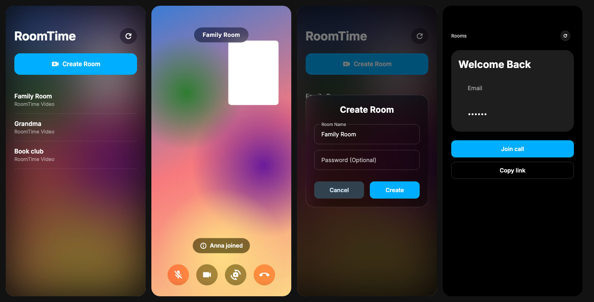

<p align="center">
  <picture>
    <source media="(prefers-color-scheme: dark)" srcset="assets/brand/logo/logo-dark-1200.png">
    
  </picture>
</p>

<p align="center">
  <a href="https://github.com/devleloper/roomtime/actions/workflows/ci.yml"></a>
  <a href="https://github.com/devleloper/roomtime/actions/workflows/codeql.yml"></a>
  <a href="LICENSE"></a>
</p>

RoomTime is an app for audio and video calls in small rooms, in a FaceTime-like interface. Anyone can create a room
without an account, share its invite link (`/r/<code>`) or 10-letter code, and protect it with an optional
password; guests join with just a display name. This repository is the **Flutter client** for Web, iOS, Android and
macOS. It talks to a RoomTime backend (room API and a LiveKit SFU), which is not part of this repository.

## Features

- **Guest-first:** no registration; you pick a display name, and the app remembers it with your recent rooms.
- **Create a room** in one dialog with a name and an optional password.
- **Invite** with a link (`https://<host>/r/abc-defg-hjk`) shared through the system share sheet, or with the
  10-letter code. Join by pasting either one; invite links open the lobby directly.
- **FaceTime-like interface:** your live camera behind a glass home screen, glass dialogs and round glass call
  controls, the room name in a Dynamic-Island-style badge, a draggable picture-in-picture view and a grid for larger
  rooms.
- **Lobby** over your camera preview with microphone and camera toggles; password prompt for protected rooms.
- **Call:** microphone and camera toggles, camera switching, participants dialog, keyboard shortcuts on desktop and
  web, automatic reconnect, audio that keeps running in the background on iOS and Android.
- **Host controls:** mute a participant's microphone, remove a participant (optionally with a ban), revoke the
  invite and issue a new code, end the room for everyone.
- **Accessible:** screen reader labels, keyboard activation and focus, 48 dp targets, large text and reduced
  motion; English and Russian.

<p align="center">
  
</p>

## Architecture

Flutter with flutter_bloc, go_router, get_it + injectable, Dio and `livekit_client`, in five layers: `app`
(composition), `core`, `domain` (entities and ports), `data` (API client, LiveKit adapter, storage) and
`presentation` (features, widgets, theme). Details: [docs/architecture.md](docs/architecture.md). Design:
[docs/design/](docs/design/flows.md).

The backend contract is [docs/api/openapi.yaml](docs/api/openapi.yaml) (OpenAPI 3.1): create, look up and join
rooms, host actions, errors as RFC 9457 problem details. Joining returns a short-lived LiveKit token and the SFU URL.

## Getting started

Requirements: Flutter 3.47.9 (stable), Xcode for iOS and macOS, Android SDK for Android, and a reachable RoomTime
backend.

```bash
cp config/local.example.json config/local.json      # set API_BASE_URL, e.g. http://localhost:8080
flutter pub get
flutter run -d chrome --dart-define-from-file=config/local.json
```

| Platform | Command | Notes |
| --- | --- | --- |
| Web | `flutter run -d chrome --dart-define-from-file=config/local.json` | Release: `flutter build web --release --no-web-resources-cdn`; an empty `API_BASE_URL` means the origin that serves the app |
| iOS Simulator | `flutter run -d <simulator> --dart-define-from-file=config/local.json` | iOS 15.0 or newer |
| Android emulator | `adb reverse tcp:8080 tcp:8080`, then `flutter run -d <emulator> --dart-define-from-file=config/local.json` | Or use `http://10.0.2.2:8080` |
| macOS | `flutter run -d macos --dart-define-from-file=config/local.json` | Debug builds are unsigned and keep the guest id in memory only |

Configuration keys: [config/README.md](config/README.md). Build-time values are compiled into the app, so they are
public URLs only, never secrets.

### Release builds

- **Android:** release signing reads `android/key.properties` (not committed); release tasks fail without it.
- **iOS and macOS:** set your team in Xcode; the app id is `dev.devlet.roomtime`.
- **App links:** invite links need your domain in the Android intent filter (`deepLinkHost` in
  `android/app/build.gradle.kts`) and the iOS Associated Domains, plus `assetlinks.json` and
  `apple-app-site-association` on that domain.

## Checks

The same checks run in CI on every pull request:

```bash
dart run build_runner build --delete-conflicting-outputs   # generated DI code must be up to date
dart format --output=none --set-exit-if-changed lib test integration_test
flutter analyze
flutter test
flutter build web --release --no-web-resources-cdn --dart-define-from-file=config/local.example.json
```

Integration tests run the real app against a backend: [integration_test/README.md](integration_test/README.md).

## Security and privacy

- TLS protects traffic to the backend; DTLS-SRTP protects media between the app and the SFU.
- **There is no end-to-end encryption.** The backend operator's SFU can access call media in plain form; optional
  media E2EE (LiveKit frame encryption, key only in the link fragment) is planned.
- Passwords travel only in request bodies, never in URLs or logs. The device keeps its guest id, display name,
  recent rooms and owner tokens in secure storage. No analytics, ads or tracking.
- Report vulnerabilities privately as described in [SECURITY.md](SECURITY.md).

## Contributing

Contributions are welcome. Read [CONTRIBUTING.md](CONTRIBUTING.md) for the setup, the checks and the commit rules
(Conventional Commits, DCO sign-off with `git commit -s`). Everyone taking part follows the
[Code of Conduct](CODE_OF_CONDUCT.md). Changes are listed in [CHANGELOG.md](CHANGELOG.md).

## License

RoomTime is free software, licensed under the GNU Affero General Public License v3.0 only
([`AGPL-3.0-only`](LICENSE)). Third-party components and their licenses are listed in [NOTICE](NOTICE).
