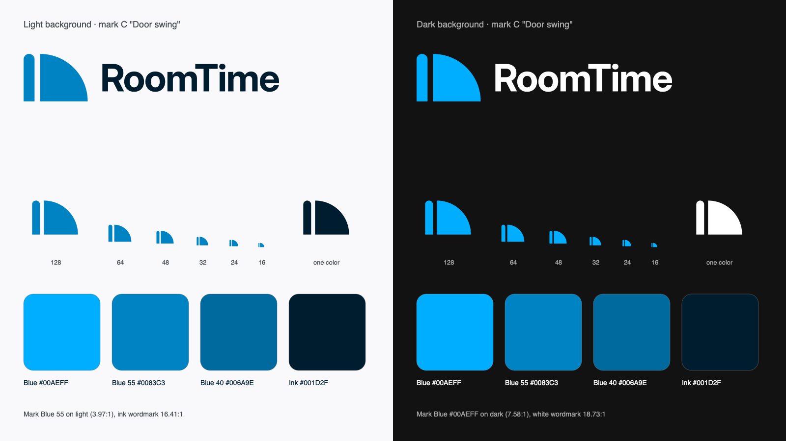
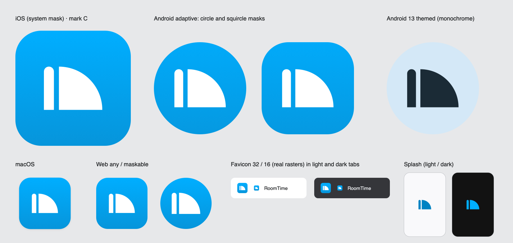
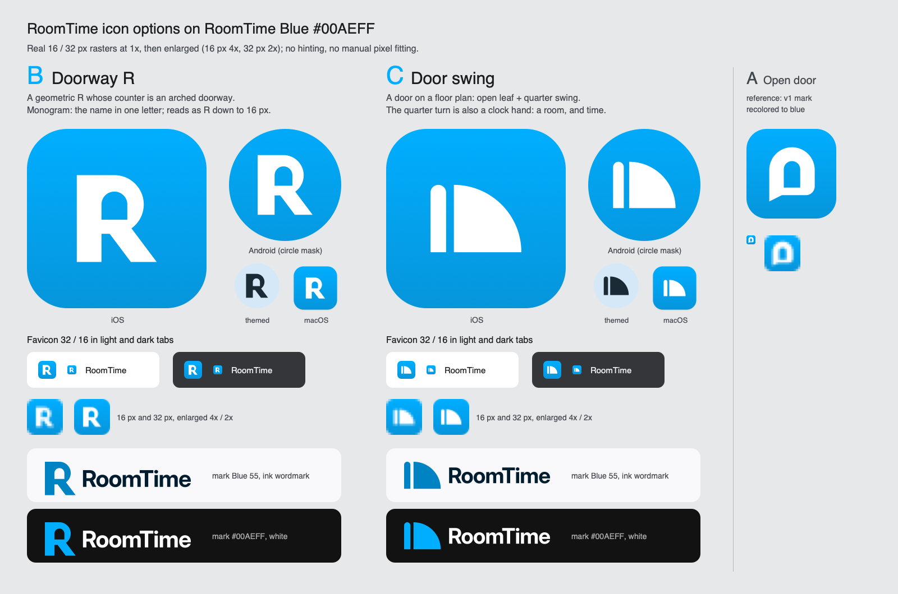

# RoomTime visual identity

Status: v2 (RoomTime Blue, icon options) · 2026-11-04 · Owner: ux-ui-designer
Code: `lib/presentation/theme/` (palette, schemes, typography), `lib/presentation/widgets/room_time_logo.dart`.
Assets: `assets/brand/` (masters in `src/`, rasters in `icon/`, `splash/`, `logo/`, build script in `tool/`).
Token tables and every contrast pair of the UI: [tokens.md](tokens.md).




## 1. Name

| Item | Value |
| --- | --- |
| Product name | **RoomTime**: one word, capital R and T, no space, no hyphen, never "Roomtime" or "ROOMTIME" in running text |
| App display name (home screen, dock, task switcher) | `RoomTime` (8 characters, within the 12-character limit) |
| Store title | `RoomTime: Video Rooms` |
| Store subtitle (proposal, iOS ≤ 30 chars) | `Open a room, share the link` |
| Tagline EN (proposal) | Open a room. Share the link. Talk. |
| Tagline RU (proposal) | Откройте комнату. Поделитесь ссылкой. Говорите. |

Copy lines are proposals; `product-analyst` decides wording, `i18n-engineer` moves any in-app string into ARB. The
name itself is a proper noun and is not translated (`RoomTime` in Russian UI too).

Audience: families, friends and small teams. The identity is warm but not domestic: no houses, hearts, people
pictograms or child-like shapes.

## 2. The mark

Status: **option C "Door swing" is the RoomTime mark** (chosen by the user 2026-11-04): production assets, the
in-app `RoomTimeLogo` and the build default. Options B and A are rejected and kept only as documented, buildable
references.



### Icon options A/B/C

| | Concept | Why | Risks |
| --- | --- | --- | --- |
| B · Doorway R (rejected) | Geometric capital R; its counter is an arched doorway (the room is open). | A monogram carries the name itself; letterforms survive blur, so B reads as "R" at 16 px in light and dark tabs. The arch keeps the "open door" story of v1 without a bubble cliché. | Next to the wordmark it repeats the R ("R RoomTime"); the lockup relies on spacing, not on a second idea. |
| **C · Door swing** (chosen) | A door drawn as on a floor plan: open leaf + its quarter-circle swing. The same quarter turn reads as a clock hand sweeping a quarter hour: a room, and time. | The only option that says both "Room" and "Time"; a rare, ownable silhouette (bar + quarter disc) that stays crisp at 16 px. | Abstract: people who don't read plans see "a bar and a quarter circle" until they learn it; wide glyph (70 × 52) needs more care in square slots. |
| A · Open door (rejected, v1 reference) | v1 arch speech bubble with a door, recoloured to blue, door cut out. | Continuity with v1. | Speech bubbles are the most common chat-app shape; the user asked for a new mark. |

All three are original geometric work (no camera, handset, people or green; nothing resembling FaceTime, Zoom, Meet,
WhatsApp or Messenger marks). Each is one color with cut-outs, so the full-color, reversed, one-color and Android
themed versions are the same path in different inks.

**Switching marks** (only if the decision is reversed):

1. `python3 assets/brand/tool/build.py --mark B` regenerates every SVG master, PNG and preview sheet
   (no flag = C).
2. Replace `_MarkPainter._mark` in `lib/presentation/widgets/room_time_logo.dart` with the path of the other
   master (B: `M14 11H46A25 25 0 0 1 60.52 56.35L82 85H60L42 61H35V85H14Z M35 49V36A11 11 0 0 1 57 36V49Z`,
   even-odd fill), set `_capHeight` (B 37) and `_artboardMargin` (B 14), change the build default, and point
   `brand_test.dart` at that master.

### Construction (96-unit grid)

Masters: `assets/brand/src/marks/roomtime-mark-{a,b,c}.svg` (hand-authored, comments carry the construction).

| | C · Door swing (chosen) | B · Doorway R (rejected) |
| --- | --- | --- |
| Glyph box | 70 × 52, x 13–83, y 22–74, centred | 68 × 74, x 14–82, y 11–85, centred |
| Parts | leaf 12 × 52, round top r 6; quarter disc r 52 = leaf length, hinge (31, 74), from 12 to 3 o'clock | stem 21 wide; bowl = semicircle r 25 at (46, 36); leg slope 3:4, foot 22 |
| Cut-out | gap 6 between leaf and swing | doorway 22 wide, arch r 11 concentric with the bowl, sill y 49 |
| Icon scale (1024 tile) | 7.4 px/unit (glyph 518 × 385 px) | 6.7 px/unit (glyph 496 px, 48 %) |
| Lockup cap height | 30 | 37 (half the glyph) |
| Painter fill | non-zero (two separate shapes) | even-odd (doorway is a hole) |

### Lockup

Horizontal only: mark, then the wordmark. Wordmark = "RoomTime" in **Inter Bold (700)**, tracking −2 %, Inter
kerning, converted to outlines. Gap between glyph and the R = 16 units; caps centred on the glyph.
Wordmark ink: Ink `#001D2F` on light, White on dark; never blue.

### Variants (any option)

| Variant | Mark | Use | Contrast |
| --- | --- | --- | --- |
| On dark | RoomTime Blue `#00AEFF` | `#121212` up to `#333333` (raised containers too) | 7.58 / 5.11:1 |
| On light | Blue 55 `#0083C3` | `#F9F9FB` up to `#E1E2E4` | 3.97 / 3.22:1 |
| Reversed | White | On RoomTime Blue tiles, on photos or video under the scrim | 2.47:1 on `#00AEFF`, 3.32:1 on `#0695DB` (launcher art, see below) |
| One color | any single ink, cut-outs stay holes | Print, embossing, Android themed icon | |

`#00AEFF` itself never draws the mark on light surfaces (2.35:1 on Paper, below WCAG 1.4.11).

### Clear space and minimum size

- **Clear space** = X on every side, X = one quarter of the glyph height. No text, edge or other logo inside it.
- **Minimum size**: mark 20 px digital, 6 mm print; below that use the favicon tile. Lockup at least
  96 px wide (cap height ≥ 8 px) / 25 mm.

### Don't

- Recolor the mark outside the variants above, add gradients, outlines, shadows or glows to the glyph.
- Rotate, mirror (also in RTL), skew or re-proportion; close the gap between leaf and swing, or turn the swing into a full or half circle.
- Put the blue mark on mid-tone or busy backgrounds: use the reversed mark on a scrim.
- Set the wordmark in live text, another font or weight; split "Room Time".
- Use the old `logo.png` (removed: unknown origin).

## 3. Color

**RoomTime Blue `#00AEFF`** is the project's main color (carried over from the original app). It is light (OKLCH L 0.72), so
roles are split by contrast: `#00AEFF` fills tiles and is the dark-theme primary; darker blues of the same hue
(OKLCH 240) carry text and marks on light surfaces. App roles with every UI pair: [tokens.md](tokens.md#color).

| Name | Hex | Role |
| --- | --- | --- |
| **RoomTime Blue** | `#00AEFF` | Icon tiles, favicon, mark on dark, dark `primary` and focus ring, light `inversePrimary` |
| Tile bottom | `#0695DB` | App icon gradient `#00AEFF` → `#0695DB` (top to bottom), artwork only |
| Blue 55 | `#0083C3` | Mark on light surfaces |
| Blue 40 | `#006A9E` | Light `primary` (text buttons, filled buttons, links) and focus ring, dark `inversePrimary` |
| Blue 30 / 90 | `#004D74` / `#CCE9FF` | Containers |
| **Ink** | `#001D2F` | Wordmark on light, light `onPrimaryContainer`; the passing label color on `#00AEFF` (6.98:1, not applied: the app keeps the 0.1.6 white label, tokens.md debt) |
| **Doorlight** | `#FFB164` | Complementary accent (OKLCH hue 64 vs 240): dark `tertiary`, one highlight per screen at most |
| Mist 10–90 | `#05131D` … `#D4E8F7` | Secondary (blue-tinted grey) |
| Apricot 10–90 | `#361900` … `#FEDFBE` | Tertiary family |
| Paper / Night | `#F9F9FB` / `#121212` | Light surface and dark background (`AppColors.background`); Night is the splash background |

**Accent decision.** Doorlight stays: it sits almost exactly opposite RoomTime Blue on the OKLCH hue wheel, so it
reads as warm against the cool blue, and the apricot tertiary roles already pass AA. It leaves the mark: on
`#00AEFF` it is only 1.38:1 (both colors are light), so it cannot carry a shape inside a blue glyph.

### Contrast (WCAG 2.2, computed, enforced by `theme_contrast_test.dart`)

| Pair | Ratio | Requirement |
| --- | --- | --- |
| `#00AEFF` on Night (dark primary text, mark on dark) | 7.58:1 | 4.5 (1.4.3) |
| `#00AEFF` on `#282828` / `#333333` (dialog actions, raised containers) | 5.97 / 5.11:1 | 4.5 / 3.0 |
| Ink `#001D2F` on `#00AEFF` (fix for the dark CTA label, not applied) | 6.98:1 | 4.5 |
| White on `#00AEFF` (dark CTA and dialog primary labels, 0.1.6) | 2.47:1 | fails 4.5: known debt, tokens.md |
| Blue 40 on Paper (light primary text) | 5.62:1 | 4.5 |
| Blue 40 on `#E7E8EA` (light dialog actions) | 4.82:1 | 4.5 |
| White on Blue 40 (light filled button) | 5.91:1 | 4.5 |
| Blue 55 on Paper / on `#E1E2E4` (mark on light) | 3.97 / 3.22:1 | 3.0 (1.4.11) |
| Ink on Paper (wordmark) | 16.41:1 | 4.5 |
| White on Night (wordmark on dark) | 18.73:1 | 4.5 |
| White on `#00AEFF` / `#0695DB` (icon glyph) | 2.47 / 3.32:1 | launcher artwork, not app UI; legibility by shape |
| `#00AEFF` on Paper | 2.35:1 | fails: never text or mark on light |
| Doorlight on `#00AEFF` | 1.38:1 | fails: never inside the mark |

`#00AEFF` is never used for text on light surfaces. White sits on it in the app-icon glyph (large launcher artwork
with a deeper gradient bottom) and in the 0.1.6 CTA and dialog primary labels (known debt, one-token fix to Ink).

### Over live video (FaceTime-style call UI)

The call screen draws white glass controls over the camera feed. Text readability does not depend on the video:

| Layer | Token | Check |
| --- | --- | --- |
| Scrim behind captions, name tags, the room pill, the Home veil | `videoScrim` black 60 % (`AppGlass.overlayMinAlpha`) | white text 5.74:1 over a pure white frame |
| HUD notices / state lines | glass black 70 % / 80 % | white text 8.45 / 12.63:1 over a white frame |
| Call controls, hang-up (0.1.6) | `LiquidBounceButton` tinted `surface` / `#FF453A` 40 % | no guaranteed ratio over bright frames (tokens.md debt) |

Brand blue is not a glass tint: blue over unknown video has no guaranteed contrast. Use it for focus rings and
active-speaker borders together with a non-color signal.

## 4. Typography

UI: the platform system font on native (SF Pro on Apple, Roboto on Android), as in dev-0.1.6; **Inter 4.1**
(variable, bundled, SIL OFL 1.1) on web, served from the app's own assets. Wordmark: Inter Bold everywhere. Three
weights in the UI: 400 body, 600 titles/labels/buttons, 700 hero titles and display. M3 sizes and line heights; Inter
tracking on web, 0 on native except the hero titles; full scale in [tokens.md](tokens.md#typography).

| Level | Style | Example |
| --- | --- | --- |
| Hero | headlineLarge 34/41 · 700 · −0.5 | "RoomTime" (Home title) |
| Screen / dialog title | headlineSmall 24/32 · 600 · −0.45 | "Join a room" |
| App bar / sheet | titleLarge 22/28 · 600 · −0.4 | "Participants" |
| Body | bodyLarge 16/24 · 400 · −0.15 | "Share the link, talk when everyone is in." |
| Button | titleMedium 16/24 · 600 · −0.15 | "Create room" |

Text scales with the system setting (tested at 200 %); the logo does not (it is an image with a fixed size).

## 5. Icon set

All rasters are generated by `python3 assets/brand/tool/build.py [--mark C|B|A]` (default C) from the mark masters (macOS CoreSVG via
`tool/render.swift`; outlines via CoreText in `tool/outline.swift`; Python standard library only, no network).

| File (`assets/brand/…`) | Size | Alpha | Platform / use |
| --- | --- | --- | --- |
| `src/roomtime-app-icon.svg` → `icon/app-icon-1024.png` | 1024 | no | iOS App Store + all iOS sizes, Play Store hi-res source |
| `icon/android/adaptive-foreground-432.png` | 432 (108 dp @4x) | yes | Adaptive foreground; mark keeps its iOS share of the visible 72 dp (+10 % for the circle mask); farthest point r = 100 px of the 132 px safe circle |
| `icon/android/adaptive-background-432.png` | 432 | no | Adaptive background (blue gradient) |
| `icon/android/adaptive-monochrome-432.png` | 432 | yes | Android 13+ themed icon (one-color mark, cut-outs stay holes) |
| `icon/macos/macos-icon-1024.png` | 1024 | yes | macOS: 824 px rounded square (radius 185) with soft shadow on the Apple grid |
| `icon/web/icon-192.png`, `icon-512.png` | 192, 512 | yes | PWA `purpose: any` (rounded tile) |
| `icon/web/icon-maskable-192.png`, `icon-maskable-512.png` | 192, 512 | no | PWA `purpose: maskable` (full bleed, mark in the 80 % safe circle) |
| `icon/web/apple-touch-icon-180.png` | 180 | no | iOS home-screen bookmark |
| `icon/web/favicon-32.png`, `favicon-16.png`, `src/favicon.svg` | 32, 16, vector | yes | Browser tab: blue tile + white mark (enlarged 12 %), legible at 16 px in light and dark tabs |
| `logo/logo-light-1200.png`, `logo-dark-1200.png` | 1200 × 224 | yes | Lockup for docs, README, store graphics |
| `logo/mark-mono-512.png` | 512 | yes | One-color mark |
| `src/roomtime-logo-{light,dark,mono}.svg`, `src/roomtime-mark{,-mono}.svg` | vector | | Generated masters of the chosen mark |
| `splash/splash-mark-{light,dark}-512.png`, `splash/splash-android12-{light,dark}-1152.png` | 512, 1152 | yes | Splash images (section 6) |
| `src/marks/roomtime-mark-{a,b,c}.svg` | vector | | Hand-authored option masters (inputs) |

Icon composition: RoomTime Blue gradient (`#00AEFF` → `#0695DB`, top to bottom), white mark C at 7.4 px/unit on
1024 (glyph 518 × 385 px, centred on its box). Preview sheets: `img/icon-sheet.png` (chosen mark on every
platform), `img/logo-sheet.png`, `img/icon-options.png` (B / C / A comparison).

## 6. Splash

Dark in every system appearance, like the app (dark-only since 0.1.6): Night `#121212` with the `#00AEFF` mark centred
(7.58:1). No wordmark, no animation (system splash; nothing to reduce for reduced motion).

| | Value |
| --- | --- |
| Background | Night `#121212` (Android `@color/splash_background`, iOS `LaunchBackground`) |
| Image (4× density, 128 dp) | `splash/splash-mark-dark-512.png` (`#00AEFF`) → Android `drawable-xxxhdpi/splash_mark.png`, iOS `LaunchImage` |
| Android 12+ icon (no icon background), mark inside the 768 px circle (reach r = 340) | `splash/splash-android12-dark-1152.png` → `drawable-xxxhdpi/splash_android12.png` |
| Web | the dark preloader in `web/index.html` on black; `manifest.json` background and theme `#000000` |

The `-light` splash rasters in `assets/brand/splash/` are kept for a later light mode and are not used.

## 7. Launcher icon config (for the rebrand task)

```yaml
flutter_launcher_icons:
  image_path: "assets/brand/icon/app-icon-1024.png"
  android: "launcher_icon"
  min_sdk_android: 21
  adaptive_icon_background: "assets/brand/icon/android/adaptive-background-432.png"
  adaptive_icon_foreground: "assets/brand/icon/android/adaptive-foreground-432.png"
  adaptive_icon_monochrome: "assets/brand/icon/android/adaptive-monochrome-432.png"
  ios: true
  remove_alpha_ios: true
  web:
    generate: false   # the generator reuses one image for maskable; copy the files below instead
  macos:
    generate: true
    image_path: "assets/brand/icon/macos/macos-icon-1024.png"
  windows:
    generate: false
```

Web, copied by hand: `icon/web/icon-192.png` → `web/icons/Icon-192.png`, `icon-512.png` → `Icon-512.png`,
`icon-maskable-192.png` / `-512.png` → `Icon-maskable-192.png` / `-512.png`, `favicon-32.png` → `web/favicon.png`,
`src/favicon.svg` → `web/favicon.svg` (add `<link rel="icon" href="favicon.svg" type="image/svg+xml">` before the PNG
link), `apple-touch-icon-180.png` → `web/icons/apple-touch-icon.png`. `manifest.json`: `"name": "RoomTime"`,
`"short_name": "RoomTime"`, `"background_color": "#000000"`, `"theme_color": "#000000"`.

Display name: `CFBundleDisplayName` / `CFBundleName` = `RoomTime` (iOS, macOS), `android:label="RoomTime"`, web
`<title>RoomTime</title>` and `apple-mobile-web-app-title`.

## 8. In the app

`RoomTimeLogo` (shared widget) draws mark C as a vector from the same geometry as `src/marks/roomtime-mark-c.svg`
(`brand_test.dart` keeps them in sync). Its blue follows the theme: `#00AEFF` in dark, Blue 55 in light.

```dart
const RoomTimeLogo()                                   // mark, 48 dp, announces "RoomTime"
const RoomTimeLogo(size: 64, showWordmark: true)       // lockup; ink follows the theme brightness
const RoomTimeLogo(reversed: true)                     // white mark on RoomTime Blue or on a video scrim
const RoomTimeLogo(showWordmark: true, semanticLabel: null) // decorative, when the name is read nearby
```

The lockup ignores text scaling and scales down as a whole in tight space (`FittedBox`), so it never overflows. It is
one semantics node (`image`, label "RoomTime").

## Assets and licenses

| Asset | Source | License | Status |
| --- | --- | --- | --- |
| RoomTime marks A, B, C (`src/marks/roomtime-mark-{a,b,c}.svg`) and every derived SVG/PNG in `assets/brand/` and `docs/design/img/` | Original work, ux-ui-designer, 2026-11-04 | Project-owned | known |
| Wordmark outlines | Inter 4.1 glyphs converted to outlines | SIL OFL 1.1 (artwork made with the font is not Font Software) | known |
| Inter 4.1 variable fonts | rsms/inter, bundled in `assets/fonts/inter/` | SIL OFL 1.1 (`OFL.txt`) | known |
| Build tools `assets/brand/tool/*` | Original, project | Project-owned | known |
| Former `assets/brand/logo.png` | unknown | unknown | removed |

`assets/brand/` subfolders are not bundled into the app (`pubspec` lists only the top-level `assets/brand/`,
which is now empty); nothing in the app needs a brand bitmap.
